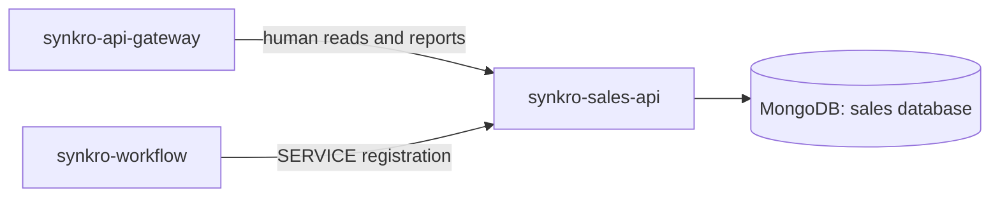

# synkro-sales-api

> Sales service that persists workflow-created sales, enforces authorship and calculates daily, monthly and top-product reports.

Part of the **SynkroTech SAS Sales Management System**. Architecture, decisions and
contracts live in [synkro-docs](https://github.com/code-corhuila/synkro-docs).

**Quick start:** from this root, configure the migrated Sales MongoDB replica set and Auth public key, then run `go run ./cmd/sales-api`. See [Getting started](#getting-started).

## What it does

- Accepts sale registration from the Workflow service with idempotency and server-calculated integer-cent totals.
- Lists and reads active sales, limiting a SALESPERSON to their own records.
- Calculates paginated reports with MongoDB aggregation pipelines.
- Stores the yearly commercial sale reference without claiming fiscal-invoice validity.
- Owns Sales behavior; synkro-sales-db owns validators, indexes and migrations.

## Where it fits



Workflow validates the customer and reserves inventory before Sales registration. Sales does not reach into another domain's database.

## Tech stack

| Component | Choice |
|---|---|
| Language / HTTP | Go 1.26.9; net/http |
| Persistence | MongoDB Go driver v2; MongoDB 7 replica set |
| Build / test | Go tools; real Mongo integration and contract scripts |
| Runtime | Docker API; internal HTTP 8080 |

## Dependencies

| Depends on | Purpose | Configuration |
|---|---|---|
| synkro-sales-db | Collection validator, indexes and commercial counter | Apply owning migrations first |
| synkro-infra-mongo | Authenticated replica set | sales_app connection |
| Auth public key | Local RS256 verification | JWT_PUBLIC_KEY or JWT_PUBLIC_KEY_FILE |
| synkro-workflow | Authorized sale registration caller | SERVICE token with sales:register |

## Getting started

Use **PowerShell or Bash** from the repository root with Go 1.26.9, a migrated replica set and protected application-only configuration:

```text
go run ./cmd/sales-api
```

The Go process consumes `MONGODB_URI` and exactly one of `JWT_PUBLIC_KEY` / `JWT_PUBLIC_KEY_FILE`. In Compose, `SALES_APP_MONGODB_URI` and `JWT_PUBLIC_KEY_PATH` supply those runtime inputs. Administrator connection strings belong only to migration/bootstrap tooling.

For the complete platform, start from [synkro-infra-postgres](https://github.com/code-corhuila/synkro-infra-postgres).

## Configuration

The committed [.env.example](.env.example) is the configuration inventory.
Its values are examples; required inputs and defaults follow its comments and the
owning implementation. Keep real secrets in protected local files.

| Variable | Purpose |
|---|---|
| `HTTP_PORT` | Http port |
| `SALES_APP_MONGODB_URI` | Connection address, origin or build-time entry point |
| `MONGODB_TIMEOUT` | Mongodb timeout |
| `MONGODB_MAX_POOL_SIZE` | Mongodb max pool size |
| `JWT_PUBLIC_KEY_PATH` | Identity key input; keep private material outside Git |

The example includes Compose-facing inputs. The actual Go process reads MONGODB_URI, JWT_PUBLIC_KEY / JWT_PUBLIC_KEY_FILE, MONGODB_TIMEOUT and MONGODB_MAX_POOL_SIZE. Keep connection credentials out of shell history.

## Interface

| Method / route | Access / result |
|---|---|
| POST /api/v1/sales | SERVICE synkro-workflow, sales:register; idempotent creation |
| GET /api/v1/sales; GET /{id} | ADMIN or SALESPERSON with sales:read; authorship enforced |
| GET /api/v1/sales/reports/daily | Authorized daily aggregation |
| GET /api/v1/sales/reports/monthly | Authorized monthly aggregation |
| GET /api/v1/sales/reports/top-products | Authorized product aggregation |
| GET /health | Public; 200 or 503 after bounded MongoDB ping |

Requests, ownership rules and exact response codes are in the [Sales contract](https://github.com/code-corhuila/synkro-docs/blob/main/07-api/contracts/openapi/synkro-sales-api.yaml).

## Project structure

```text
cmd/sales-api/       process entry and wiring
internal/domain/    sale rules and integer money
internal/application/ use cases and ports
internal/adapter/   HTTP/JWT and MongoDB persistence
scripts/            real-engine, coverage and contract tools
tests/              provider/consumer contract fixtures
docs/               deployment, persistence and report details
```

## Testing

```text
go build ./...
go vet ./...
go test ./...
```

Unit tests are distinct from real MongoDB persistence tests and provider-contract checks. Run the source-documented integration/contract launchers only with their disposable fixtures; detailed commands and provenance remain in the testing and persistence guide.

## Branching and contributing

Use a `feat/`, `fix/` or `chore/` child branch and a PR into `develop`.
Permanent branches are `develop`, `qa` and `main`; none accepts direct commits.
Promote through a `qa-<description>` or release child with `git cherry-pick -x`.
`main` requires approval from `ariel5253`. Use English Conventional Commits.
See [Git conventions](https://github.com/code-corhuila/synkro-docs/blob/main/00-governance/git-conventions.md).

## Further documentation

- [Local development](docs/local-development.md).
- [Http endpoints](docs/http-endpoints.md).
- [Reports](docs/reports.md).
- [Testing](docs/testing.md).
- [Persistence and integration](docs/persistence-and-integration.md).
- [Domain rules](https://github.com/code-corhuila/synkro-docs/blob/main/02-domain/entities-and-rules.md), [contracts](https://github.com/code-corhuila/synkro-docs/tree/main/07-api/contracts/openapi) and [testing strategy](https://github.com/code-corhuila/synkro-docs/blob/main/11-quality/testing-strategy.md).

<!-- Preserve previously published README section links. -->
<a id="running-locally"></a>
<a id="sales-http-endpoints-hu-ven-09"></a>
<a id="sales-reports-hu-ven-10"></a>
<a id="aggregation-design"></a>
<a id="toolchain-and-vulnerability-scanning"></a>
<a id="running-the-tests"></a>
<a id="mongodb-persistence"></a>
<a id="real-integration-tests"></a>
<a id="contract-review-notes-for-hu-ven-09"></a>
<a id="branching"></a>
<a id="contract-tests-tier-3-of-11-qualitytesting-strategymd"></a>
<a id="consumer-driven-qa-contracts"></a>
